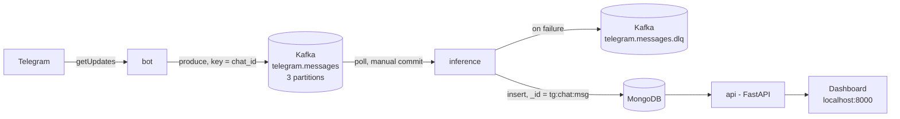
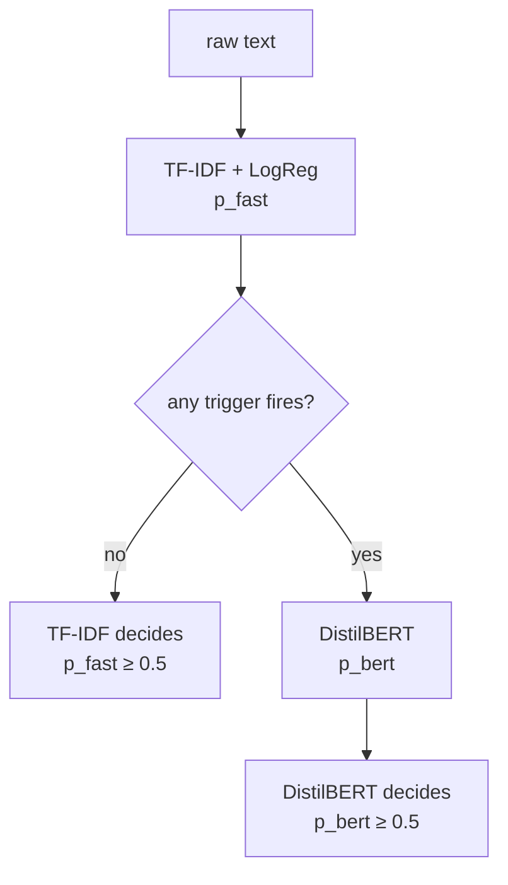

# Distress Detector

Detects emotional distress in Telegram messages, in real time.

A Telegram bot publishes incoming messages to Kafka. An inference service scores each message
with a **two-model cascade** — a fast TF-IDF model that decides most messages on its own, and a
fine-tuned DistilBERT that is consulted only when the fast model is likely to be wrong — and
stores the result in MongoDB. A FastAPI service exposes the results and serves a small live
dashboard. Everything runs with one `docker compose up`.

> Built as a ground-up rebuild of an earlier version, with a focus on clear boundaries, typed
> contracts between services, and at-least-once delivery without duplicates.
> Full design notes and the reasoning behind every decision: `[DESIGN.md](DESIGN.md)`.

---


## Architecture




| Service                | Role                                                                                | Image extras           |
| ---------------------- | ----------------------------------------------------------------------------------- | ---------------------- |
| `bot`                  | Long-polls Telegram, converts updates to `IncomingMessage`, produces to Kafka       | `kafka`, `bot` (no ML) |
| `inference`            | Consumes from Kafka, runs the cascade, stores to MongoDB, sends failures to the DLQ | `ml`, `kafka`, `mongo` |
| `api`                  | `/predict`, `/messages`, `/stats`, `/health`, and the dashboard page                | `ml`, `mongo`, `api`   |
| `kafka` / `kafka-init` | Single KRaft broker; topics created explicitly before services start                | —                      |
| `kafka-ui`             | Web UI for topics, messages, consumer groups and the DLQ                            | —                      |


---


## The cascade




**Escalation triggers** (Strategy pattern, each one configurable):


| Trigger       | Fires when                                                          | Why                                                                                          |
| ------------- | ------------------------------------------------------------------- | -------------------------------------------------------------------------------------------- |
| `uncertainty` | `0.25 ≤ p_fast ≤ 0.75`                                              | the fast model is not sure                                                                   |
| `negation`    | the raw text contains a negation (`not`, `no`, `don't`, `can’t`, …) | a bag-of-words model sees *not* and *okay*, not that one negates the other                   |
| `audit`       | a deterministic sample of messages (SHA-256 of the message id)      | monitoring agreement between the models without labels — **off by default** (`AUDIT_RATE=0`) |


After escalation, DistilBERT decides alone (no weighted average). Every result records **who
decided and why**:

```json
{
  "is_distress": true,
  "p_distress": 0.96,
  "decided_by": "distilbert",
  "escalation_reasons": ["uncertainty", "negation"],
  "p_fast": 0.37,
  "p_bert": 0.96
}
```

Examples from the running system:


| Message                                        | TF-IDF | Triggers              | Decision                      |
| ---------------------------------------------- | ------ | --------------------- | ----------------------------- |
| *Great game last night, what a goal!*          | 0.23   | —                     | TF-IDF: not distress          |
| *I am not okay*                                | 0.37   | uncertainty, negation | DistilBERT 0.96: **distress** |
| *I feel so hopeless, I cannot do this anymore* | 0.75   | negation              | DistilBERT 0.98: **distress** |


### Models

Both models are trained, frozen, and loaded from the Hugging Face Hub
(`Hliran2/distilbert-distress-detector`) at a **pinned commit** (`HF_REVISION`). No retraining
happens in this project.


| Model                        | F1    | Recall | Precision | ROC-AUC |
| ---------------------------- | ----- | ------ | --------- | ------- |
| TF-IDF + Logistic Regression | 0.931 | 0.933  | 0.929     | 0.977   |
| DistilBERT (fine-tuned)      | 0.938 | 0.951  | 0.925     | 0.985   |


Test-set metrics from training. Data: 10,193 Reddit posts, balanced 50/50, labeled by subreddit
(proxy labels). The models are English-only.

`preprocess.py` (used by the TF-IDF model only) is copied verbatim from training and exists in
exactly one place, to avoid training–serving skew. `nltk`, `numpy`, `scikit-learn` and
`transformers` are pinned to the training environment.

---


## Reliability

**Rule at every hop: acknowledge upstream only after the next stage has confirmed.**

- **Bot → Kafka:** the Telegram offset (the acknowledgement) moves only after Kafka confirms the
batch (`flush` + delivery callbacks). A crash in between makes Telegram resend.
- **Kafka → MongoDB:** auto-commit is disabled; the consumer commits an offset only after the
message was stored **or** sent to the DLQ (`BaseKafkaConsumer`, Template Method).
- **Duplicates are harmless:** the stable id `tg:{chat_id}:{message_id}` is MongoDB's `_id`, so a
redelivered message raises `DuplicateKeyError`, which is caught (and is the only exception
caught on write). At-least-once delivery + idempotent writes.
- **Poison pills never block a partition:** any failure in `handle` sends the original message to
the DLQ with the error type, message, and source topic / partition / offset / key.
- **Graceful shutdown** on `SIGTERM` in the bot and the consumer.
- **Ordering per chat:** messages are keyed by `chat_id`, so one chat always lands in one
partition. Up to 3 inference replicas can share the work (`--scale inference=3`).

---


## Quick start

**Prerequisites:** Docker Desktop, a Telegram bot token (from [@BotFather](https://t.me/BotFather)),
and a MongoDB connection string (e.g. Atlas).

```bash
cp .env.example .env        # then fill in TELEGRAM_BOT_TOKEN, MONGO_URI and HF_REVISION
docker compose up -d --build
```


| URL                                                      | What                                                                   |
| -------------------------------------------------------- | ---------------------------------------------------------------------- |
| [http://localhost:8000](http://localhost:8000)           | Dashboard: stats, a predict box, latest messages (refreshes every 5 s) |
| [http://localhost:8000/docs](http://localhost:8000/docs) | API documentation (Swagger UI)                                         |
| [http://localhost:8080](http://localhost:8080)           | Kafka UI: topics, messages, consumer groups, DLQ                       |


Send a message (in English) to your bot on Telegram; it appears on the dashboard within seconds.

---


## API


| Endpoint             | Description                                                                    |
| -------------------- | ------------------------------------------------------------------------------ |
| `POST /predict`      | Score a text. Body: `{"text": "..."}` (1–5,000 chars). Not stored.             |
| `GET /messages`      | Stored messages, newest first. Query: `limit` (1–100), `offset`, `is_distress` |
| `GET /messages/{id}` | One stored message, or `404`                                                   |
| `GET /stats`         | `{"total", "distress", "escalated"}`                                           |
| `GET /health`        | Models loaded and MongoDB reachable                                            |


---


## Configuration

All settings are environment variables (read from `.env`), validated at startup with
pydantic-settings; a missing or invalid value stops the service immediately.


| Variable                                                     | Default                                       | Used by                                          |
| ------------------------------------------------------------ | --------------------------------------------- | ------------------------------------------------ |
| `TELEGRAM_BOT_TOKEN`                                         | *required*                                    | bot                                              |
| `TELEGRAM_POLL_TIMEOUT`                                      | `30`                                          | bot                                              |
| `MONGO_URI`                                                  | *required*                                    | api, inference                                   |
| `MONGO_DB`                                                   | `reddit_distress_db`                          | api, inference                                   |
| `MONGO_COLLECTION`                                           | `telegram_posts`                              | api, inference                                   |
| `HF_REPO_ID`                                                 | `Hliran2/distilbert-distress-detector`        | api, inference                                   |
| `HF_REVISION`                                                | *required* (commit hash)                      | api, inference (also a Docker build arg)         |
| `KAFKA_BOOTSTRAP`                                            | `kafka:9092`                                  | bot, inference (`localhost:29092` from the host) |
| `KAFKA_TOPIC` / `KAFKA_DLQ_TOPIC`                            | `telegram.messages` / `telegram.messages.dlq` | bot, inference                                   |
| `FAST_THRESHOLD` / `BERT_THRESHOLD`                          | `0.5` / `0.5`                                 | api, inference                                   |
| `UNCERTAINTY_ENABLED`, `UNCERTAINTY_LOW`, `UNCERTAINTY_HIGH` | `true`, `0.25`, `0.75`                        | api, inference                                   |
| `NEGATION_ENABLED`                                           | `true`                                        | api, inference                                   |
| `AUDIT_RATE`                                                 | `0` (off)                                     | api, inference                                   |


---


## Project structure

```
.
├── pyproject.toml                   # one shared package with optional extras
├── src/distress_core/               # shared library: no Kafka / Mongo / FastAPI in the core
│   ├── contracts/                   # Pydantic models passed between services
│   │   ├── messages.py              #   IncomingMessage (Kafka) + build_message_id
│   │   ├── prediction.py            #   PredictionResult, DecidedBy
│   │   ├── records.py               #   TelegramMessageRecord (MongoDB)
│   │   └── dead_letter.py           #   DeadLetter (DLQ)
│   ├── models/                      # DistressModel (ABC), FastModel, BertModel
│   ├── preprocessing/preprocess.py  # verbatim copy from training
│   ├── escalation/                  # EscalationTrigger (ABC) + triggers
│   ├── cascade.py                   # Cascade
│   ├── factory.py                   # build_cascade(settings)
│   ├── settings.py                  # Cascade / Mongo / Kafka / Telegram settings
│   ├── storage/repository.py        # MessageRepository (MongoDB)
│   └── messaging/base.py            # BaseKafkaConsumer, producer helpers
├── services/
│   ├── bot/                         # telegram.py, convert.py, main.py, Dockerfile
│   ├── inference/                   # consumer.py, main.py, Dockerfile
│   └── api/                         # main.py, schemas.py, static/index.html, Dockerfile
├── tests/                           # unit tests (pytest)
└── docker-compose.yml
```

**Dependency direction:** `services → messaging / storage → cascade / triggers / models → contracts`.
The core takes text and returns a result; each service only wires parts together. Services
install only the extras they need — the bot image has no PyTorch.

---


## Design highlights

- **Inheritance where there are several implementations, plain classes where there is one.**
`DistressModel` has two subclasses, `EscalationTrigger` three; `MessageRepository` has one
implementation and no interface.
- **Patterns:** Strategy (triggers), Template Method (`BaseKafkaConsumer.handle`),
Repository (`MessageRepository`), factory methods (`from_hub`, `from_message`, `connect`),
dependency injection throughout (constructors take ready objects, so tests use fakes).
- **Typed contracts:** every message between services is one Pydantic class imported by both
sides; timestamps are timezone-aware UTC (`AwareDatetime`), converted once, at the edge.
- **Composition over inheritance for configuration:** one small settings class per concern;
each service takes the ones it needs.
- **Secrets stay out of logs:** the bot token is a `SecretStr`, and Telegram HTTP errors are
re-raised without the URL (which contains the token).
- **No blocking in async code:** FastAPI endpoints are plain `def` (run in a thread pool); the
Kafka services are plain synchronous loops.
- **Models baked into the images** at build time, with `HF_HUB_OFFLINE=1` at runtime.

---


## Local development

```bash
python3.12 -m venv .venv && source .venv/bin/activate
pip install torch==2.6.0 --index-url https://download.pytorch.org/whl/cpu   # plain `pip install torch==2.6.0` on macOS
pip install -e ".[ml,mongo,kafka,api,bot,dev]"
python -c "import nltk; nltk.download('punkt_tab'); nltk.download('averaged_perceptron_tagger_eng')"

pytest                                                   # unit tests, no network needed
uvicorn services.api.main:app --reload                   # API on :8000
KAFKA_BOOTSTRAP=localhost:29092 python -m services.bot.main
KAFKA_BOOTSTRAP=localhost:29092 python -m services.inference.main
```

---


## Limitations and next steps

- **English only** — the models were trained on English Reddit posts.
- **Proxy labels** — training labels come from subreddits, not manual annotation.
- **Monitoring** — the audit trigger exists but is off; enabling it needs an agreement metric in
`/stats`.
- **Tests** — unit tests cover the cascade and the triggers; API and Kafka-consumer tests are next.
- **Kafka storage** — the broker has no volume; `docker compose down` clears topics (results are
safe in MongoDB).
- **No authentication** on the API or the dashboard.

